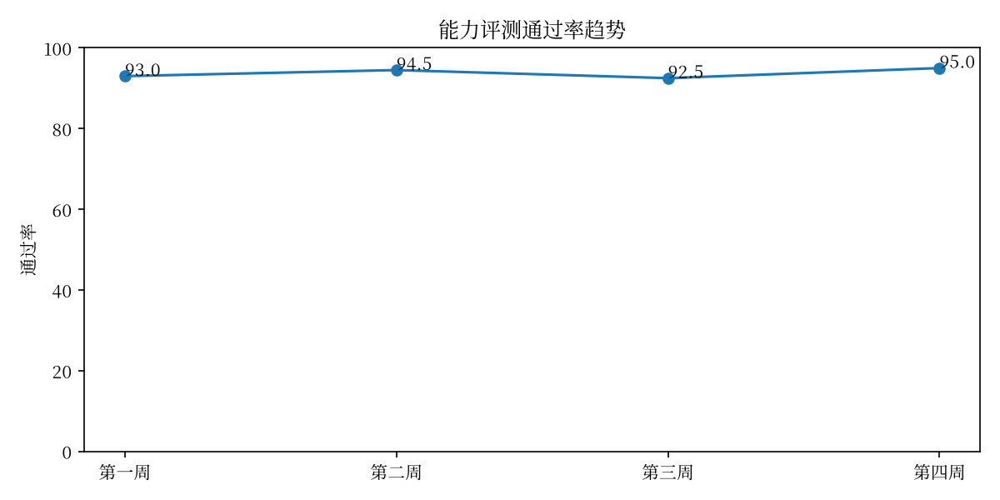
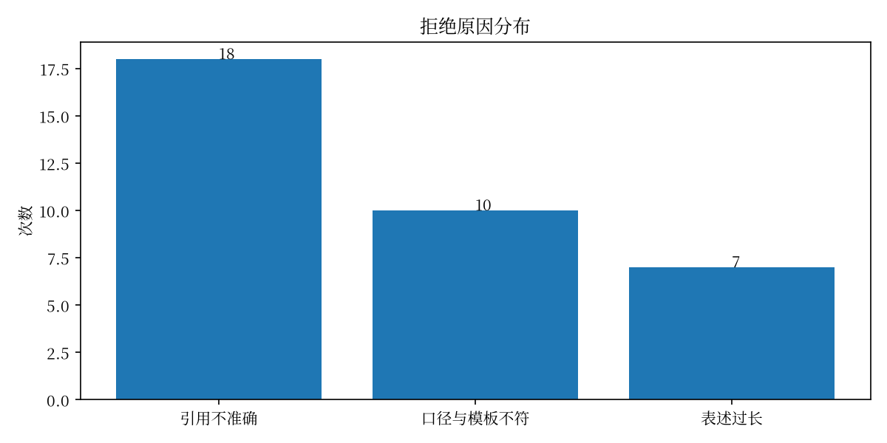

# 会员空间平台质量月报（2026年11月）

## 一、本月结论
本月结论三至五条，由审阅人填写，系统只预填数据事实作为提示：
- 本月最高通过率为 96.5%，来自问答助手；最低通过率为 88.5%，来自知识库问答。
- P0 失败数为 0 起。
- 知识库问答样本量为 40，已标记为样本量不足。

## 二、能力评测
| 工具 | 通过率 | 样本量 | 备注 |
| --- | --- | --- | --- |
| 问答助手 | 96.5% | 200 | 正常 |
| 商机匹配助手 | 92.0% | 160 | 正常 |
| 知识库问答※ | 88.5% | 40 | 样本量不足 |
| 招商助手 | 94.0% | 120 | 正常 |

## 三、护栏与红队
本月无 P0 失败

## 四、采纳与修改幅度
| 工具 | 使用次数 | 修改次数 | 拒绝次数 |
| --- | --- | --- | --- |
| 问答助手 | 320 | 45 | 12 |
| 商机匹配助手 | 210 | 30 | 9 |
| 知识库问答 | 80 | 11 | 6 |
| 招商助手 | 150 | 22 | 8 |

## 五、Top 失败模式
| 失败模式 | 出现次数 | 是否已人工复核 |
| --- | --- | --- | --- |
| 引用过期政策 | 9 | 已人工复核 |
| 数字与来源不一致 | 6 | 已人工复核 |
| 拒绝原因未分类 | 4 | 待人工复核 |

## 六、下月改进事项
下月改进事项从未关闭的红队发现与退化事件自动列出，负责人角色可编辑：
- 跟进引用过期政策的复核结论（负责人：红队负责人，下月十日前）
- 补齐样本量不足工具的评测样本（负责人：评测负责人，下月十日前）

## 七、附录
口径说明：通过率等于通过样本数除以样本总数；样本量不足的行以灰色显示并加脚注；报告中的所有数字均由程序从数据集填入。
数据截至时间：2026-11-30
套件版本清单：
- 评测套件 2.3.1
- 红队套件 1.8.0

注：灰色行为样本量不足（low_sample）的行，数据仅供参考。
